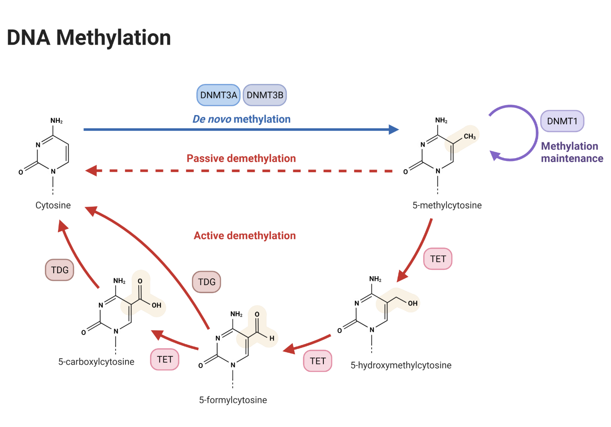
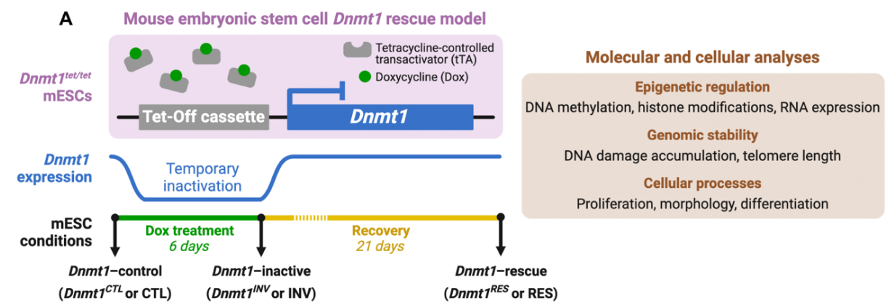
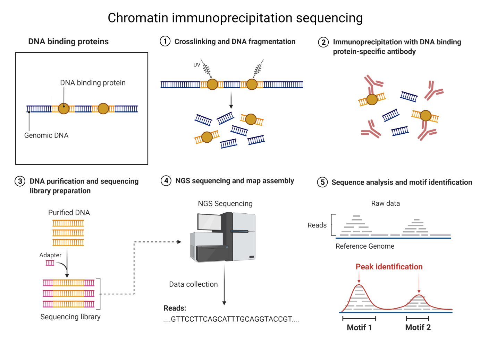
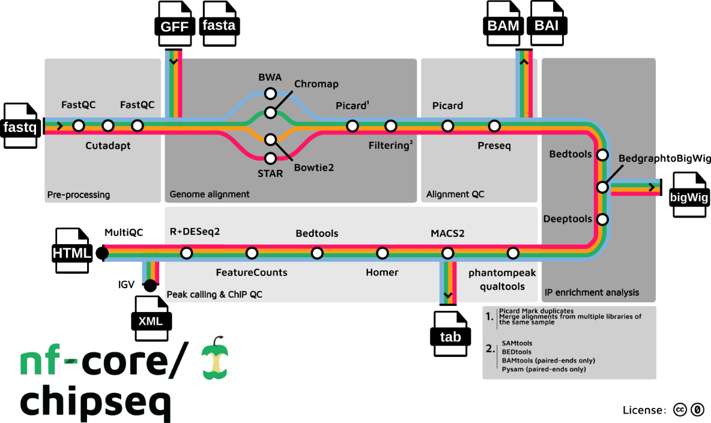
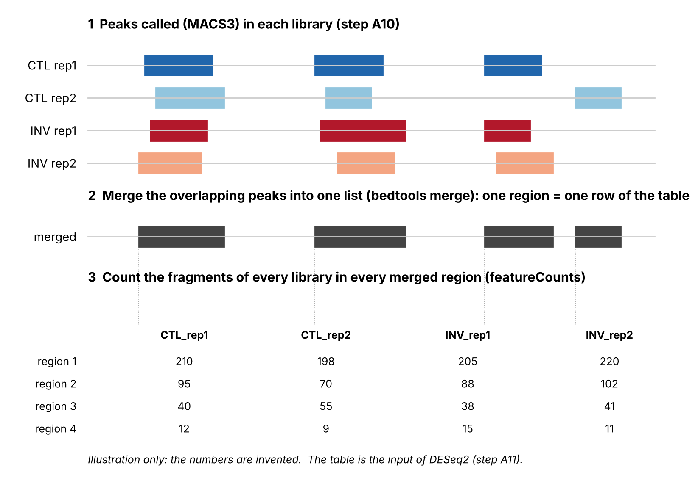
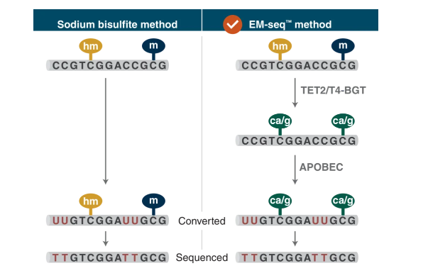
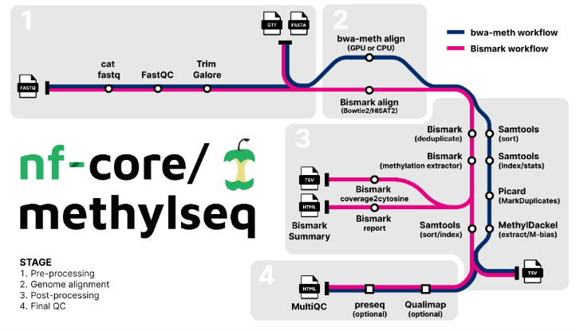

# Epigenomics Practical

Rita Rebollo – 4th year INSA students (8h Practical)

Updated November 2026

**Objective :** learn how to analyze ChIP-seq and whole genome methylation data (either bisulfite or EM-seq)

**Dataset** : 1. Elder, E. et al. Rescuing DNMT1 fails to fully reverse the molecular and functional repercussions of its loss in mouse embryonic stem cells. Nucleic Acids Res 53, gkaf130 (2025).

|                     |                                                                                                       |
|---------------------|-------------------------------------------------------------------------------------------------------|
| **Cells**           | Mouse embryonic stem cells, *Dnmt1* Tet-Off line, male                                                |
| **Conditions used** | **CTL** = untreated · **INV** = doxycycline 6 days (Dnmt1 switched off)                               |
| **ChIP-seq**        | H3K4me3 and H3K27me3, 2 replicates per condition, 1 input per condition. Paired-end 2×50 bp           |
| **DNA methylation** | EM-seq (enzymatic methyl-seq), 2 replicates per condition. Paired-end 2×150 bp                        |
| **Genome**          | Mouse mm10 (GRCm38)                                                                                   |
| **Tools**           | FastQC, MultiQC, Trim Galore, Bowtie2, samtools, MACS3, deepTools, bedtools, Bismark, R (DESeq2, DSS) |

**Learning objectives:**

- ChIP-seq and EM-seq QC
- Align ChIP-seq reads (Bowtie2) and EM-seq reads (Bismark); assess alignment quality and duplicates.
- Understand why ChIP-seq needs an input sample.
- Call peaks with MACS3, and compare conditions with a statistical test (DESeq2).
- Understand how ChIP signal can be normalised.
- Call methylation, inspect the conversion rate and the M-bias plot.
- Call differentially methylated regions (DMRs) with DSS.
- Visualise the data with deepTools, IGV and the UCSC genome browser, and relate histone changes to DNA methylation changes.

## 1. The biological question
DNMT1 (DNA methyltransferase 1) copies DNA methylation onto the new strand after each DNA replication (*maintenance* methylation).




In this cell line, DNMT1 can be switched off with doxycycline (Tet-Off system). Below a figure from the paper summarizes the model and their analyses.




The authors asked what happens to DNA methylation and to histone marks when DNMT1 is lost, but most importantly, can DNMT1 loss phenotype be rescued after recovery. Here we use only two conditions, **CTL** (untreated) and **INV** (DNMT1 switched off) for the sake of time, but students are free to explore the rescue condition if interested (after finishing the practical). We will focus on two of the histone marks they profiled: **H3K4me3** (potentially active promoters, euchromatin) and **H3K27me3** (Polycomb repression, facultative heterochromatin), in addition to genome wide DNA methylation profiles. The authors also provide RNAseq but we will not have time to study it this practical, but the data is available if students are interested in duplicating the authors work.

The authors data is available at the BioProject PRJNA1108734 (ChIP-seq), PRJNA1108731 (EM-seq); GEO GSE267053 if the students would like to pursue the analysis on their own after the practical.

**How this practical works.** For each step you first run the commands on a **small dataset**, so that every command finishes quickly and you can look at its output. Then you can fetch the **report of the same step on the complete dataset produced by your instructor**, so that you can compare it with your own result. Once the reads are aligned, you will work on the complete data, restricted to chromosome 12.

## 2. Setup
### 2.0.0 Log in to the cluster
For security reasons, you need to be connected to the INSA network, so please connect yourself either to the INSA ethernet or use a INSA VPN. Each team has an identifier from etud1 to etud10.

ssh etud3@bf2i-galaxy

Enter your password. After three mistaken trials, your IP is blocked, so please, if you get it wrong two times in a row, close your session (Ctrl +C) and restart the connection.

### 2.0 Work within a screen

```bash
# create a screen that will differentiate your work from the group 2 so don’t call it : practical epigenomics
screen -S MYUNIQUENAMESCREEN   #also don’t call it MYUNIQUENAMESCREEN because someone will…

# to close the screen without killing the jobs: CTRL A  + D

# to kill the screen and lose all commands ongoing: CTRL D

# to attach to a screen that exists
screen -r MYUNIQUENAMESCREEN
```

### 2.1 Activate the environment
**Why conda?** A conda environment is a folder that holds the programs of the practical in exact, tested versions (FastQC, Bowtie2, MACS3, deepTools, Bismark, R with DESeq2 and DSS...) together with everything they depend on. Activating it only changes where your terminal looks for programs, so every student runs the same versions without installing anything. Nothing is changed outside your terminal session: close it, or run `conda deactivate`, and everything is back as before.

```bash
# load conda into this shell
source /opt/miniconda3/etc/profile.d/conda.sh

# switch on the environment used for the whole practical
# (FastQC, Trim Galore, Bowtie2, MACS3, deepTools, Bismark, bedtools, R with DESeq2 and DSS)
conda activate /home/data/biosciences/Practical_Epigenomics/conda_env/epigenomics
```

### 2.2 Create your working directory
```bash
# make one sub-folder per type of file (-p = no error if it exists)
mkdir -p ~/epigenomics_practical/fastq
mkdir -p ~/epigenomics_practical/fastqc
mkdir -p ~/epigenomics_practical/trimmed
mkdir -p ~/epigenomics_practical/aligned
mkdir -p ~/epigenomics_practical/multiqc
mkdir -p ~/epigenomics_practical/reports_full
mkdir -p ~/epigenomics_practical/chip_bam
mkdir -p ~/epigenomics_practical/peaks
mkdir -p ~/epigenomics_practical/diffpeaks
mkdir -p ~/epigenomics_practical/bigwig
mkdir -p ~/epigenomics_practical/deeptools
mkdir -p ~/epigenomics_practical/annotation
mkdir -p ~/epigenomics_practical/bismark_aligned
mkdir -p ~/epigenomics_practical/methylation
mkdir -p ~/epigenomics_practical/emseq_cov
mkdir -p ~/epigenomics_practical/dmr

# go into it
cd ~/epigenomics_practical

# a shortcut for the shared data folder; every "$SHARED" below means this path
SHARED=/home/data/biosciences/Practical_Epigenomics
#to verify your parameter
echo $SHARED #should print /home/data/biosciences/Practical_Epigenomics
```

### 2.3 Copy files to your laptop (scp)
Reports (HTML), plots (PDF) and tracks (bigWig) must be copied to your laptop to be opened. Type these commands **in a terminal on your laptop, not on the cluster**. Replace `username` by your login; the final `.` means “into the current folder of the laptop”.

```bash
# one file
scp username@bf2i-galaxy.insa-lyon.fr:~/epigenomics_practical/multiqc/multiqc_chip_raw_small.html .


#all the HTML files of a folder (the quotes are needed)
scp "username@bf2i-galaxy.insa-lyon.fr:~/epigenomics_practical/multiqc/*.html" .

# a whole folder (-r = recursive)
scp -r username@bf2i-galaxy.insa-lyon.fr:~/epigenomics_practical/deeptools .
```

> **Box1 : one CPU only**
>
> Every command below uses one CPU (`-t 1`, `--cores 1`, `-p 1`). **Bismark** is the exception to be aware of: it starts two Bowtie2 programs at the same time (one for each converted genome), so it can use two CPUs.

> **Box2 : reading the commands**
>
> A backslash `\` at the end of a line only means “the command continues on the next line”. Lines starting with `#` are comments: you can paste them, they do nothing.

## Part A — ChIP-seq

As discussed during the class, we will analyse Chromatin immunoprecipitation sequencing datasets. Remeber what we know about ChIP-seq:




And here is the analysis pipeline that we will roughly follow: we will QC with FastQC and MultiQC, trim with trim-galore which holds Cutadapt, map with Bowtie2, filter duplicate reads with samtools (fixmate and markdup) instead of Picard (both work), use Bedtools and Deeptools for normalization and visualization, MACS3 for peak calling, FeatureCounts for count estimation at peaks, and DESEQ2 for differential binding analysis.




### Step A1 — Copy the small dataset \[time: 1 s\]

```bash
# we will use the first 500 000 read pairs of H3K4me3 (CTL replicate 1) and of the CTL input. 
cp $SHARED/small_fastq/H3K4me3_CTL_rep1_R1.fastq.gz fastq/
cp $SHARED/small_fastq/H3K4me3_CTL_rep1_R2.fastq.gz fastq/
cp $SHARED/small_fastq/input_CTL_R1.fastq.gz fastq/
cp $SHARED/small_fastq/input_CTL_R2.fastq.gz fastq/
```

R1 and R2 are the two ends (mates) of the same DNA fragment: paired-end sequencing. A FASTQ file stores, for each read, its name, its sequence and the quality of each base.

```bash
# verify you copied all the four files
ls fastq
```

The full dataset comprises two paired-end files for each replicate of control and DNMT1 inactive (INV), for H3K4me3 and H3K27me3, along with the inputs. We will not use all the files. The objective here is to have an idea of the command and the output.

### Step A2 — Quality control of the raw reads \[time: 45 s\]

```bash
# FastQC: one quality report per FASTQ file (-t 1 = one thread, --outdir = output folder). 
fastqc -t 1 fastq/H3K4me3_CTL_rep1_R1.fastq.gz fastq/H3K4me3_CTL_rep1_R2.fastq.gz fastq/input_CTL_R1.fastq.gz fastq/input_CTL_R2.fastq.gz --outdir fastqc/

# MultiQC: merges all FastQC reports into one HTML page (-n = name, -q = quiet)
multiqc fastqc/ -o multiqc/ -n multiqc_chip_raw_small -q
```

Open `multiqc/multiqc_chip_raw_small.html` (copy it to your laptop with `scp`, see section 2.3). Look at: per-base quality, adapter content, duplication level.

```bash
scp username@bf2i-galaxy.insa-lyon.fr:~/epigenomics_practical/multiqc/multiqc_chip_raw_small.html .
```

**Compare with the complete dataset.** Your instructor ran the same FastQC on all the reads of all the ChIP-seq libraries (8 ChIP + 2 inputs). Command below.

**Datasets used (Elder et al. 2025; ChIP-seq PRJNA1108734).** Each library was sequenced as paired-end reads: file R1 holds the first mate of every pair and file R2 the second mate (the files are named `<library>_R1.fastq.gz` and `<library>_R2.fastq.gz`). The two conditions are CTL (untreated Dnmt1 Tet-Off cells) and INV (doxycycline), two replicates each; one input per condition is used as the control of the peak calling.

| **Library**       | **Condition**     | **Replicate** | **ChIP antibody** |
|-------------------|-------------------|---------------|-------------------|
| H3K4me3_CTL_rep1  | CTL (untreated)   | 1             | H3K4me3           |
| H3K4me3_CTL_rep2  | CTL (untreated)   | 2             | H3K4me3           |
| H3K4me3_INV_rep1  | INV (doxycycline) | 1             | H3K4me3           |
| H3K4me3_INV_rep2  | INV (doxycycline) | 2             | H3K4me3           |
| H3K27me3_CTL_rep1 | CTL (untreated)   | 1             | H3K27me3          |
| H3K27me3_CTL_rep2 | CTL (untreated)   | 2             | H3K27me3          |
| H3K27me3_INV_rep1 | INV (doxycycline) | 1             | H3K27me3          |
| H3K27me3_INV_rep2 | INV (doxycycline) | 2             | H3K27me3          |
| input_CTL         | CTL (untreated)   | \-            | none (input)      |
| input_INV         | INV (doxycycline) | \-            | none (input)      |


```bash
# the MultiQC report of the complete libraries
cp $SHARED/reports/chip/multiqc_chip_1_raw.html reports_full/
```

> **Discussion 1**
>
> Why are INPUT reads more abundant than IP reads?
>
> Should we trim the datasets? For quality? For adaptors?

### Step A3 — Trim adapters \[time: 14 s\]

```bash
# Trim Galore: removes adapters and low-quality ends; --paired keeps R1 and R2 and removes reads where the mate didn’t pass the QC;
# --fastqc runs FastQC on the trimmed reads; --cores 1 = one CPU
#One command per paired-end libraries.
trim_galore --paired --fastqc --cores 1 fastq/H3K4me3_CTL_rep1_R1.fastq.gz fastq/H3K4me3_CTL_rep1_R2.fastq.gz --output_dir trimmed/
trim_galore --paired --fastqc --cores 1 fastq/input_CTL_R1.fastq.gz fastq/input_CTL_R2.fastq.gz --output_dir trimmed/
```

Look at the trimming reports (`trimmed/*_trimming_report.txt`): which adapter was found, and how many reads were shortened?

### Step A4 — Quality control again, after trimming \[time: 4 s\]

```bash
# merge the trimming reports and the post-trimming FastQC reports 
multiqc trimmed/ -o multiqc/ -n multiqc_chip_trimmed_small -q

# the same report for the complete libraries
cp $SHARED/reports/chip/multiqc_chip_2_trimmed.html reports_full/
```

> **Discussion 2**
>
> Compare adapter content and read length before and after trimming. Why can reads shorter than ~20 bp not be kept?

### Step A5 — Align with Bowtie2, filter, remove duplicates \[time: 11 min 55 s\]

> **Box 3: mapping quality (MAPQ) and the “q15” files**
>
> Every alignment has a mapping quality (MAPQ): a Phred-scaled estimate of the probability that the read is placed at the wrong position, Q = −10 × log10(P). A MAPQ of 15 means roughly a 3% chance of being wrong. Low values mark reads that fit equally well at several places (repeats). `-q 15` keeps alignments with MAPQ ≥ 15 (the cut-off used in the paper) and `-f 2` keeps properly paired reads. In the file names, `q15` = the BAM file after this filter, before duplicates are removed, and `dedup` = after duplicate removal. Bowtie2’s MAPQ is an estimate, not an exact probability.


```bash
# Bowtie2 aligns the pairs to mm10 (-x = index; -1/-2 = the two mates; -p 1 = one thread).
# "2>" saves the alignment summary in a log file. The "|" sends the output straight to samtools:
# view -b -f 2 -q 15 keeps only properly paired reads (-f 2) with mapping quality >= 15 (-q 15), the last – tells samtools to use the output from the pipe "|" 
# and writes a compressed BAM file (-b).
bowtie2 -x $SHARED/index/mm10 -1 trimmed/H3K4me3_CTL_rep1_R1_val_1.fq.gz -2 trimmed/H3K4me3_CTL_rep1_R2_val_2.fq.gz -p 1 2> aligned/small_H3K4me3_CTL_rep1_bowtie2.log | samtools view -b -f 2 -q 15 -o aligned/small_H3K4me3_CTL_rep1.q15.bam -
bowtie2 -x $SHARED/index/mm10 -1 trimmed/input_CTL_R1_val_1.fq.gz -2 trimmed/input_CTL_R2_val_2.fq.gz -p 1 2> aligned/small_input_CTL_bowtie2.log | samtools view -b -f 2 -q 15 -o aligned/small_input_CTL.q15.bam -

# Duplicate removal needs 4 small steps (same 4 lines for each sample):
# (1) sort reads by name -n, so that mates are next to each other, necessary for fixmate
samtools sort -n -o aligned/small_H3K4me3_CTL_rep1.nsort.bam aligned/small_H3K4me3_CTL_rep1.q15.bam
# (2) fixmate -m adds the information needed to recognize duplicate pairs
samtools fixmate -m aligned/small_H3K4me3_CTL_rep1.nsort.bam aligned/small_H3K4me3_CTL_rep1.fixmate.bam
# (3) sort again, by genome position for markdup
samtools sort -o aligned/small_H3K4me3_CTL_rep1.csort.bam aligned/small_H3K4me3_CTL_rep1.fixmate.bam
# (4) markdup -r removes the duplicate pairs
samtools markdup -r aligned/small_H3K4me3_CTL_rep1.csort.bam aligned/small_H3K4me3_CTL_rep1.dedup.bam

samtools sort -n -o aligned/small_input_CTL.nsort.bam aligned/small_input_CTL.q15.bam
samtools fixmate -m aligned/small_input_CTL.nsort.bam aligned/small_input_CTL.fixmate.bam
samtools sort -o aligned/small_input_CTL.csort.bam aligned/small_input_CTL.fixmate.bam
samtools markdup -r aligned/small_input_CTL.csort.bam aligned/small_input_CTL.dedup.bam

# index the final BAM files (needed by IGV and deepTools)
samtools index aligned/small_H3K4me3_CTL_rep1.dedup.bam
samtools index aligned/small_input_CTL.dedup.bam

# look at the Bowtie2 summaries
cat aligned/small_H3K4me3_CTL_rep1_bowtie2.log
cat aligned/small_input_CTL_bowtie2.log
```

**IGV inspection:** On your laptop, download a couple of the BAM files, then open them in IGV (genome mm10).

### Step A6 — Quality control of the alignment \[time: 6 s\]

```bash
# flagstat: counts of reads by category (mapped, paired, duplicates...)
samtools flagstat aligned/small_H3K4me3_CTL_rep1.q15.bam > aligned/small_H3K4me3_CTL_rep1.q15.flagstat.txt
samtools flagstat aligned/small_H3K4me3_CTL_rep1.dedup.bam > aligned/small_H3K4me3_CTL_rep1.dedup.flagstat.txt
samtools flagstat aligned/small_input_CTL.q15.bam > aligned/small_input_CTL.q15.flagstat.txt
samtools flagstat aligned/small_input_CTL.dedup.bam > aligned/small_input_CTL.dedup.flagstat.txt

# one MultiQC page with the alignment and flagstat results (the q15 and dedup flagstat files are shown)
multiqc aligned/ -o multiqc/ -n multiqc_chip_aligned_small -q

# the same report for the complete libraries
cp $SHARED/reports/chip/multiqc_chip_3_alignment.html reports_full/
```

> **Discussion 3**
>
> What fraction of read pairs is lost at each filter (unaligned, mapping quality \< 15, duplicates)? Is the loss the same in ChIP and in input?

### Step A7 — Work on the complete data, chromosome 12 **only** \[time: 5 s\]

From now on you use the **complete, de-duplicated alignments of all libraries**, restricted to chromosome 12 so that every command stays fast on one CPU.

```bash
# BAM files (and their indexes .bai) of the 10 libraries, chromosome 12 only
cp $SHARED/chip_chr12_bam/*.bam chip_bam/
cp $SHARED/chip_chr12_bam/*.bam.bai chip_bam/

# annotation: TSS, promoters, CpG islands (chromosome 12)
cp $SHARED/annotation/* annotation/

# check: you should have 10 BAM files
ls chip_bam/*.bam | wc -l
```

**IGV inspection:** On your laptop, download the BAM files (and their index files `.bai`) and the annotation folder, then open them in IGV (genome mm10, region chr12). Also download the annotation files for chrm12, found on /annotation.

### Step A8 — Understand the input \[time: 27 min 03 s\]

> **Box4 : the input control**
>
> The input is the same chromatin, processed identically, but without the antibody. It shows where reads accumulate for reasons that have nothing to do with the mark: open chromatin that shears more easily, repeats, copy-number changes, GC bias. A ChIP signal only means something relative to this background. Here there is one input per condition, used for both marks and both replicates of that condition.


```bash
# plotFingerprint: sorts the genome into bins from the one with the fewest reads to the one with the most,
# and draws the cumulative fraction of reads. A curve that stays low and then rises steeply = reads
# concentrated in few bins (enrichment); a diagonal = reads spread evenly (like an input).
# One command for all 10 libraries (8 ChIP + 2 inputs). --region chr12 = sample bins on chromosome 12 only (our BAM files
# contain nothing else, so bins elsewhere would all be empty). --extendReads = use the whole fragment between the mates;
# --outQualityMetrics and --outRawCounts save the numbers behind the plot.
plotFingerprint -b chip_bam/H3K4me3_CTL_rep1.chr12.bam chip_bam/H3K4me3_CTL_rep2.chr12.bam chip_bam/H3K4me3_INV_rep1.chr12.bam chip_bam/H3K4me3_INV_rep2.chr12.bam chip_bam/H3K27me3_CTL_rep1.chr12.bam chip_bam/H3K27me3_CTL_rep2.chr12.bam chip_bam/H3K27me3_INV_rep1.chr12.bam chip_bam/H3K27me3_INV_rep2.chr12.bam chip_bam/input_CTL.chr12.bam chip_bam/input_INV.chr12.bam --labels K4me3_CTL_1 K4me3_CTL_2 K4me3_INV_1 K4me3_INV_2 K27me3_CTL_1 K27me3_CTL_2 K27me3_INV_1 K27me3_INV_2 input_CTL input_INV --region chr12 --extendReads -p 1 -o deeptools/fingerprint_all.pdf --outRawCounts deeptools/fingerprint_counts.tsv --outQualityMetrics deeptools/fingerprint_metrics.tsv
```

Your instructor made the same plot on the **whole genome** (all chromosomes, all reads). Copy it to compare:

```bash
cp $SHARED/reports/chip/fingerprint_wholegenome.pdf reports_full/
```

> **Discussion 4**
>
> Compare the fingerprint curves of the two inputs with those of the H3K4me3 and H3K27me3 libraries. Do the two marks look alike? Do CTL and INV replicates overlap?
>
> You can find a detailed explanation of PlotFingerprint and ChiP QC in the deepTools suite: https://deeptools.readthedocs.io/en/latest/content/tools/plotFingerprint.html

### Step A9 — Do the replicates and conditions group together? \[time: 2 min 41 s\]

```bash
# multiBamSummary bins: counts reads in consecutive 10 kb windows of chromosome 12 (--region chr12) for all BAM files
multiBamSummary bins --bamfiles chip_bam/H3K4me3_CTL_rep1.chr12.bam chip_bam/H3K4me3_CTL_rep2.chr12.bam chip_bam/H3K4me3_INV_rep1.chr12.bam chip_bam/H3K4me3_INV_rep2.chr12.bam chip_bam/H3K27me3_CTL_rep1.chr12.bam chip_bam/H3K27me3_CTL_rep2.chr12.bam chip_bam/H3K27me3_INV_rep1.chr12.bam chip_bam/H3K27me3_INV_rep2.chr12.bam chip_bam/input_CTL.chr12.bam chip_bam/input_INV.chr12.bam --labels K4me3_CTL_1 K4me3_CTL_2 K4me3_INV_1 K4me3_INV_2 K27me3_CTL_1 K27me3_CTL_2 K27me3_INV_1 K27me3_INV_2 input_CTL input_INV --binSize 10000 --region chr12 --extendReads -p 1 -o deeptools/bins.npz

# correlation heatmap and PCA of those counts
plotCorrelation -in deeptools/bins.npz --corMethod spearman --whatToPlot heatmap --plotNumbers -o deeptools/correlation_heatmap.pdf
plotPCA -in deeptools/bins.npz -o deeptools/pca.pdf
```

> **Discussion 5**
>
> Open the PDF and look at the correlation values. Which libraries are grouped by the clustering? What is the value between the two replicates of one condition, between CTL and INV of the same mark, and between two different marks?

### Step A10 — Call peaks with MACS3, using the matching input \[time: 23 s\]

**How MACS calls peaks.** (1) With paired-end data (`-f BAMPE`) MACS3 uses the real fragment of each read pair. (2) The input is scaled to the same number of reads as the ChIP. (3) For every position MACS computes the number of reads expected by chance (lambda) from the input, and takes the highest value found in windows of several sizes (300 bp, 1 kb, 5 kb, 10 kb) and of the whole genome: this is the local lambda, which accounts for local biases of the chromatin. (4) A Poisson test compares the ChIP reads to this expected value; regions above the cut-off are enriched and overlapping regions are merged into one peak. (5) The p-values are corrected for the number of tests (Benjamini-Hochberg), and the default cut-off is q \< 0.05. If you want to read more: https://hbctraining.github.io/Intro-to-ChIPseq/lessons/05_peak_calling_macs.html

```bash
# macs3 callpeak: -t = ChIP, -c = control (input) of the SAME condition, -f BAMPE = paired-end BAM,
# -g = size of the genome the reads can fall in (chr12 ~ 120 Mb: approximate), -n = name, --outdir = folder.
# H3K4me3 gives sharp peaks: default (narrow) mode.
macs3 callpeak -t chip_bam/H3K4me3_CTL_rep1.chr12.bam -c chip_bam/input_CTL.chr12.bam -f BAMPE -g 120000000 -n H3K4me3_CTL_rep1 --outdir peaks/
macs3 callpeak -t chip_bam/H3K4me3_CTL_rep2.chr12.bam -c chip_bam/input_CTL.chr12.bam -f BAMPE -g 120000000 -n H3K4me3_CTL_rep2 --outdir peaks/
macs3 callpeak -t chip_bam/H3K4me3_INV_rep1.chr12.bam -c chip_bam/input_INV.chr12.bam -f BAMPE -g 120000000 -n H3K4me3_INV_rep1 --outdir peaks/
macs3 callpeak -t chip_bam/H3K4me3_INV_rep2.chr12.bam -c chip_bam/input_INV.chr12.bam -f BAMPE -g 120000000 -n H3K4me3_INV_rep2 --outdir peaks/

# H3K27me3 forms wide domains: --broad
macs3 callpeak -t chip_bam/H3K27me3_CTL_rep1.chr12.bam -c chip_bam/input_CTL.chr12.bam -f BAMPE -g 120000000 --broad -n H3K27me3_CTL_rep1 --outdir peaks/
macs3 callpeak -t chip_bam/H3K27me3_CTL_rep2.chr12.bam -c chip_bam/input_CTL.chr12.bam -f BAMPE -g 120000000 --broad -n H3K27me3_CTL_rep2 --outdir peaks/
macs3 callpeak -t chip_bam/H3K27me3_INV_rep1.chr12.bam -c chip_bam/input_INV.chr12.bam -f BAMPE -g 120000000 --broad -n H3K27me3_INV_rep1 --outdir peaks/
macs3 callpeak -t chip_bam/H3K27me3_INV_rep2.chr12.bam -c chip_bam/input_INV.chr12.bam -f BAMPE -g 120000000 --broad -n H3K27me3_INV_rep2 --outdir peaks/

# how many peaks per sample?
wc -l peaks/*Peak

The columns on *_peaks.xls:** chr; start and end (1-based, the end base is included: unlike BED); length (end - start + 1); abs_summit (position of the highest point); pileup (height of the pile of reads at the summit); -log10(pvalue); fold_enrichment (ChIP versus the local lambda, at the summit); -log10(qvalue) (p-value corrected for the number of tests); name. With --broad, the pileup, p-value, q-value and fold enrichment are the mean over the region.
```

**IGV inspection.** Download the peak files and open them in IGV together with the BAM files and tracks you already loaded.

> **Discussion 6**
>
> Why does each condition use its own input?
>
> Why is H3K27me3 called with `--broad` and H3K4me3 with the default (narrow) mode?

### Step A11 — Which H3K4me3 regions change between CTL and INV? \[time: 1 min 05 s\]

> Box 5: differential peaks
>
> Saying “this peak is present in CTL and absent in INV” is not reliable: a peak can be “absent” only because it fell just under the calling threshold. A differential analysis works differently: (1) build one common set of regions from the peaks of all samples; (2) count the fragments of every sample in every region (with featureCounts, as the nf-core ChIP-seq pipeline does); (3) use a statistical test that asks whether the difference between conditions is larger than the difference between replicates, and correct for testing thousands of regions at once (FDR). This is the same logic as differential gene expression. We use DESeq2, which models counts and their variability. Note that MACS3 does not do this: it compares each sample with its input (is there a peak here?), not CTL with INV.




First, the common set of regions and the counts (in the shell):

```bash
# 1) put the peaks of all four H3K4me3 samples in one list (columns 1-3 = chr, start, end), sort them, and merge overlapping ones into ONE common set of regions.
# cat joins the four peak files into one list. | (pipe) sends the output of a command to the next command. cut -f1-3 keeps the fields (columns) 1 to 3 of every line, i.e. chromosome, start and end (a narrowPeak file has 10 columns; bedtools merge only needs the three first). sort -k1,1 -k2,2n sorts the lines by column 1 (the chromosome, as text) and then by column 2 (the start, as a number: n); bedtools merge needs a sorted file. bedtools merge -i - merges the regions that overlap or touch into one region (-i - = the input is the pipe). > writes the result in a file. wc -l counts the lines of the file, i.e. the number of merged regions.

cat peaks/H3K4me3_CTL_rep1_peaks.narrowPeak peaks/H3K4me3_CTL_rep2_peaks.narrowPeak peaks/H3K4me3_INV_rep1_peaks.narrowPeak peaks/H3K4me3_INV_rep2_peaks.narrowPeak | cut -f1-3 | sort -k1,1 -k2,2n | bedtools merge -i - > diffpeaks/H3K4me3_merged_peaks.bed
wc -l diffpeaks/H3K4me3_merged_peaks.bed

Why only H3K4me3? In this practical the differential analysis is done for H3K4me3 only: doing the same for H3K27me3 (broad regions) and then drawing the heatmaps over more regions would be too long for the time of the practical. You can do it if you want, after the practical: merge the *_peaks.broadPeak files of the H3K27me3 libraries and run the same steps (featureCounts, then DESeq2).
```

**IGV inspection.** Download the merged BED file and the narrowPeak files of Step A10 and load them in IGV one above the other (one track per file) to see how overlapping peaks become one region.

**SAF versus GTF (evidence: Subread/featureCounts user guide, not re-fetched this session):** featureCounts needs an annotation that tells which regions to count. A GTF file has 9 columns (chromosome, source, feature type, start, end, score, strand, frame, attributes) and describes genes, exons, etc. A SAF (Simplified Annotation Format) file has only 5 columns (`GeneID`, `Chr`, `Start`, `End`, `Strand`) with a header line, and the coordinates are 1-based. SAF is made for regions that are not genes, like our peaks: no feature types and attributes are needed. The `GeneID` is the name of the region; here the name is chromosome_start_end.


```bash
# 2) featureCounts reads regions in "SAF" format: a header line, then one line per region with GeneID, Chr, Start (1-based), End, Strand
# awk '...' file reads the file line by line. BEGIN{...} runs once, before the first line: OFS="\t" sets the output field separator to a tab, and print "GeneID","Chr","Start","End","Strand" writes the header of the SAF file. The second block {...} runs for every line of the BED file: $1, $2 and $3 are the columns 1, 2 and 3 (chromosome, start, end). $1"_"$2"_"$3 builds the region name (chr_start_end); $1 is the chromosome; $2+1 is the start plus one, because a BED file counts from 0 and a SAF file from 1; $3 is the end; "." means that the strand is unknown. The output is written in the .saf file with >.
awk 'BEGIN{OFS="\t"; print "GeneID","Chr","Start","End","Strand"} {print $1"_"$2"_"$3, $1, $2+1, $3, "."}' diffpeaks/H3K4me3_merged_peaks.bed > diffpeaks/H3K4me3_merged_peaks.saf

# 3) featureCounts: count the fragments of every sample in every region.
# -p --countReadPairs = paired-end data, count each pair once;  -F SAF = format of the regions (-a);  -T 1 = one thread
featureCounts -p --countReadPairs -F SAF -a diffpeaks/H3K4me3_merged_peaks.saf -o diffpeaks/H3K4me3_featureCounts.txt -T 1 chip_bam/H3K4me3_CTL_rep1.chr12.bam chip_bam/H3K4me3_CTL_rep2.chr12.bam chip_bam/H3K4me3_INV_rep1.chr12.bam chip_bam/H3K4me3_INV_rep2.chr12.bam

# the summary written next to the counts: how many fragments fall inside the regions?
cat diffpeaks/H3K4me3_featureCounts.txt.summary
```

Your chr12 table holds only the regions of one chromosome (about 4% of the genome): too few to detect a difference between CTL and INV. Your instructor ran exactly the same commands on the **complete BAM files** (all chromosomes). Copy that count table and compare the two:

```bash
# the count table of the whole genome (made by the instructor with the same commands)
cp $SHARED/de_genome/H3K4me3_featureCounts.txt diffpeaks/H3K4me3_featureCounts_wholegenome.txt

# number of lines (regions + 2 header lines): your chr12 table and the whole-genome table
wc -l diffpeaks/H3K4me3_featureCounts.txt diffpeaks/H3K4me3_featureCounts_wholegenome.txt
```

Then the test the differences between CTL and INV, in R using DESeq2, **on the whole-genome table** (same environment, nothing to switch):

```bash
# start R
R
```
```r
# load the package
library(DESeq2)

# read the whole-genome count table of featureCounts (skip = 1 skips its first comment line)
counts <- read.table("diffpeaks/H3K4me3_featureCounts_wholegenome.txt", header = TRUE, sep = "\t", skip = 1)

# the 4 count columns (7 to 10), with short sample names; each region is named by its Geneid which is the peak name from the SAF
count_matrix <- as.matrix(counts[, 7:10])
colnames(count_matrix) <- c("CTL_rep1", "CTL_rep2", "INV_rep1", "INV_rep2")
rownames(count_matrix) <- counts$Geneid

# tell DESeq2 which sample belongs to which condition (CTL is the reference)
sample_info <- data.frame(condition = factor(c("CTL", "CTL", "INV", "INV"), levels = c("CTL", "INV")), row.names = colnames(count_matrix))

# build the DESeq2 object and run the model
dds <- DESeqDataSetFromMatrix(countData = count_matrix, colData = sample_info, design = ~ condition)
dds <- DESeq(dds)

# the comparison: INV versus CTL. A POSITIVE log2FoldChange = MORE H3K4me3 in INV than in CTL
res <- results(dds, contrast = c("condition", "INV", "CTL"))
summary(res)

# coordinates of the regions in BED format (BED start = featureCounts Start - 1)
regions <- data.frame(chr = counts$Chr, start = counts$Start - 1, end = counts$End)

# save the full table (region coordinates + DESeq2 results)
res_table <- data.frame(regions, as.data.frame(res))
write.table(res_table, "diffpeaks/H3K4me3_DESeq2_results.tsv", sep = "\t", quote = FALSE, row.names = FALSE)

# how many regions pass an adjusted p-value (corrected for the number of regions tested) of 0.05 and of 0.1?
cat("adjusted p < 0.05:", sum(res$padj < 0.05, na.rm = TRUE), "\n")

# CANDIDATE regions for the heatmaps: raw p-value < 0.01 and a change of at least 0.6 in log2
# (the fold-change cut-off of the paper). Raw p-values are NOT corrected for multiple testing. 

up <- res_table[!is.na(res_table$pvalue) & res_table$pvalue < 0.01 & res_table$log2FoldChange >= 0.6, 1:3]
down <- res_table[!is.na(res_table$pvalue) & res_table$pvalue < 0.01 & res_table$log2FoldChange <= -0.6, 1:3]
write.table(up, "diffpeaks/H3K4me3_up_in_INV.bed", sep = "\t", quote = FALSE, row.names = FALSE, col.names = FALSE)
write.table(down, "diffpeaks/H3K4me3_down_in_INV.bed", sep = "\t", quote = FALSE, row.names = FALSE, col.names = FALSE)
cat("candidate regions up in INV:", nrow(up), "   candidate regions down in INV:", nrow(down), "\n")
```

**IGV inspection:** download the UP and DOWN BED files and load them in IGV with the tracks, to look at some of the regions.

```bash
# a volcano plot in a PDF
```
```r
pdf("diffpeaks/H3K4me3_DESeq2_plots.pdf")

# every region is grey by default
colours <- rep("grey70", nrow(res))
# pink = significant (adjusted p < 0.05) and more H3K4me3 in INV (log2 fold change of 0.6 or more)
colours[which(res$padj < 0.05 & res$log2FoldChange >= 0.6)] <- "hotpink"
# blue = significant (adjusted p < 0.05) and less H3K4me3 in INV (log2 fold change of -0.6 or less)
colours[which(res$padj < 0.05 & res$log2FoldChange <= -0.6)] <- "dodgerblue"
```
```bash
plot(res$log2FoldChange, -log10(res$padj), pch = 20, cex = 0.5, col = colours, xlab = "log2 fold change (INV / CTL)", ylab = "-log10 adjusted p-value", main = "H3K4me3: INV versus CTL")
abline(v = c(-0.6, 0.6), h = -log10(0.05), lty = 2)
legend("topright", legend = c("up in INV", "down in INV", "not significant"), col = c("hotpink", "dodgerblue", "grey70"), pch = 20, bty = "n")
```
```bash
dev.off()

# leave R
q()
```

> **Discussion 6**
>
> What is the risk of using raw p-values when 90,000 regions are tested?
>
> What do the volcano plot (fold change versus significance) show?

### Step A12 — Signal tracks and normalisation \[time: 11 min 22 s\]

A coverage track (bigWig) turns reads into a signal along the genome. Before comparing two samples, the signal must be **normalised**, and there are different ways to do it.

```bash
# (A) 1x normalisation with bamCoverage (RPGC = reads per genomic content): the counts are scaled so that
# the AVERAGE coverage over the genome is 1x, whatever the sequencing depth.
# --effectiveGenomeSize = size of the genome the reads come from. Our BAM files contain only chr12, so we use
# the size of chr12 (~120 Mb, approximate). On a whole-genome BAM of mouse mm10 you would use the genome's
# effective size (2308125349).
# --region chr12 = make the track for chromosome 12 only (our BAM files contain nothing else): much faster.
bamCoverage -b chip_bam/H3K4me3_CTL_rep1.chr12.bam -o bigwig/H3K4me3_CTL_rep1.bw --binSize 25 --normalizeUsing RPGC --effectiveGenomeSize 120000000 --region chr12 --extendReads -p 1
bamCoverage -b chip_bam/H3K4me3_CTL_rep2.chr12.bam -o bigwig/H3K4me3_CTL_rep2.bw --binSize 25 --normalizeUsing RPGC --effectiveGenomeSize 120000000 --region chr12 --extendReads -p 1
bamCoverage -b chip_bam/H3K4me3_INV_rep1.chr12.bam -o bigwig/H3K4me3_INV_rep1.bw --binSize 25 --normalizeUsing RPGC --effectiveGenomeSize 120000000 --region chr12 --extendReads -p 1
bamCoverage -b chip_bam/H3K4me3_INV_rep2.chr12.bam -o bigwig/H3K4me3_INV_rep2.bw --binSize 25 --normalizeUsing RPGC --effectiveGenomeSize 120000000 --region chr12 --extendReads -p 1
bamCoverage -b chip_bam/H3K27me3_CTL_rep1.chr12.bam -o bigwig/H3K27me3_CTL_rep1.bw --binSize 25 --normalizeUsing RPGC --effectiveGenomeSize 120000000 --region chr12 --extendReads -p 1
bamCoverage -b chip_bam/H3K27me3_CTL_rep2.chr12.bam -o bigwig/H3K27me3_CTL_rep2.bw --binSize 25 --normalizeUsing RPGC --effectiveGenomeSize 120000000 --region chr12 --extendReads -p 1
bamCoverage -b chip_bam/H3K27me3_INV_rep1.chr12.bam -o bigwig/H3K27me3_INV_rep1.bw --binSize 25 --normalizeUsing RPGC --effectiveGenomeSize 120000000 --region chr12 --extendReads -p 1
bamCoverage -b chip_bam/H3K27me3_INV_rep2.chr12.bam -o bigwig/H3K27me3_INV_rep2.bw --binSize 25 --normalizeUsing RPGC --effectiveGenomeSize 120000000 --region chr12 --extendReads -p 1
bamCoverage -b chip_bam/input_CTL.chr12.bam -o bigwig/input_CTL.bw --binSize 25 --normalizeUsing RPGC --effectiveGenomeSize 120000000 --region chr12 --extendReads -p 1
bamCoverage -b chip_bam/input_INV.chr12.bam -o bigwig/input_INV.bw --binSize 25 --normalizeUsing RPGC --effectiveGenomeSize 120000000 --region chr12 --extendReads -p 1

# (B) NO normalisation: the raw number of fragments per 25 bp bin (CTL and INV, H3K4me3 replicate 1)
bamCoverage -b chip_bam/H3K4me3_CTL_rep1.chr12.bam -o bigwig/H3K4me3_CTL_rep1_raw.bw --binSize 25 --normalizeUsing None --region chr12 --extendReads -p 1
bamCoverage -b chip_bam/H3K4me3_INV_rep1.chr12.bam -o bigwig/H3K4me3_INV_rep1_raw.bw --binSize 25 --normalizeUsing None --region chr12 --extendReads -p 1

# (C) normalisation BY THE INPUT with bamCompare: for each bin, log2 of (ChIP / input), each BAM first
# scaled by its number of reads. The input of the same condition is used.
bamCompare -b1 chip_bam/H3K4me3_CTL_rep1.chr12.bam -b2 chip_bam/input_CTL.chr12.bam --operation log2 --region chr12 --extendReads --binSize 25 -p 1 -o bigwig/H3K4me3_CTL_rep1_log2_over_input.bw
bamCompare -b1 chip_bam/H3K4me3_INV_rep1.chr12.bam -b2 chip_bam/input_INV.chr12.bam --operation log2 --region chr12 --extendReads --binSize 25 -p 1 -o bigwig/H3K4me3_INV_rep1_log2_over_input.bw
bamCompare -b1 chip_bam/H3K27me3_CTL_rep1.chr12.bam -b2 chip_bam/input_CTL.chr12.bam --operation log2 --region chr12 --extendReads --binSize 25 -p 1 -o bigwig/H3K27me3_CTL_rep1_log2_over_input.bw
bamCompare -b1 chip_bam/H3K27me3_INV_rep1.chr12.bam -b2 chip_bam/input_INV.chr12.bam --operation log2 --region chr12 --extendReads --binSize 25 -p 1 -o bigwig/H3K27me3_INV_rep1_log2_over_input.bw

# (D) RPKM, the scaling used for the tracks of the paper (reads per kilobase per million reads): corrects for sequencing depth only.
# Here the 'million reads' are the reads of our chr12 BAM files, not of the whole genome. 
bamCoverage -b chip_bam/H3K4me3_CTL_rep1.chr12.bam -o bigwig/H3K4me3_CTL_rep1_RPKM.bw --binSize 25 --normalizeUsing RPKM --region chr12 --extendReads -p 1
bamCoverage -b chip_bam/H3K4me3_INV_rep1.chr12.bam -o bigwig/H3K4me3_INV_rep1_RPKM.bw --binSize 25 --normalizeUsing RPKM --region chr12 --extendReads -p 1
# the same for H3K27me3 (used in Step C2)
bamCoverage -b chip_bam/H3K27me3_CTL_rep1.chr12.bam -o bigwig/H3K27me3_CTL_rep1_RPKM.bw --binSize 25 --normalizeUsing RPKM --region chr12 --extendReads -p 1
bamCoverage -b chip_bam/H3K27me3_INV_rep1.chr12.bam -o bigwig/H3K27me3_INV_rep1_RPKM.bw --binSize 25 --normalizeUsing RPKM --region chr12 --extendReads -p 1
```

**IGV inspection:** Download from the cluster (`scp`) the tracks of H3K4me3 replicate 1, CTL and INV, in their three versions: `*_raw.bw`, the 1x track `H3K4me3_*_rep1.bw` and `*_log2_over_input.bw`. Load them in IGV (mm10) and go to a gene promoter on chr12 (for example the *Fos* locus, `chr12:85,468,735-85,479,114`). Set the same scale for CTL and INV within each version. Compare CTL with INV in each version, and compare the versions with each other. Add the input track if you want to see the background. You can also load the `*_RPKM.bw` tracks (D) and compare them with the 1x tracks.

> **Discussion 7**
>
> What does each normalisation correct for (sequencing depth, background, both)? What does each assume? Which one would you use to compare CTL with INV at a promoter? Which one to compare two marks in the same sample? What can go wrong if a mark changes globally between conditions?

### Step A13 — Signal profiles around the TSS and at the differential regions \[time: 25 min 56 s\]

The candidate regions of Step A11 cover all chromosomes, but your tracks contain only chromosome 12: the regions on other chromosomes have no signal and are removed by `--skipZeros`, so the heatmaps show the candidate regions that lie on chr12.

The clusters made by `--kmeans` start from random positions, so two runs can give slightly different clusters. Look at what the clusters have in common (signal at the TSS, spread around it) and whether CTL and INV differ within each cluster.

```bash
# computeMatrix: reads the signal in a window of 3 kb on each side of every chr12 TSS
# `computeMatrix reference-point` computes the signal around one point of every region (and not along the
# whole region). `--referencePoint TSS` = that point is the TSS (start) of every region of the file given with
# `-R`. `-b 3000 -a 3000` = 3000 bp before (`-b`) and 3000 bp after (`-a`) that point. `-R` = the regions file
# (BED) here the TSS of chr12. `-S` = the signal files (bigWig), one per sample. `--skipZeros` = skip the
# regions where all the signal values are zero. `-p 1` = one processor. `-o` = the output matrix, read by
# plotProfile and plotHeatmap.
computeMatrix reference-point --referencePoint TSS -b 3000 -a 3000 -R annotation/mm10_TSS_chr12.bed -S bigwig/H3K4me3_CTL_rep1.bw bigwig/H3K4me3_CTL_rep2.bw bigwig/H3K4me3_INV_rep1.bw bigwig/H3K4me3_INV_rep2.bw --skipZeros -p 1 -o deeptools/matrix_TSS_H3K4me3.gz
computeMatrix reference-point --referencePoint TSS -b 3000 -a 3000 -R annotation/mm10_TSS_chr12.bed -S bigwig/H3K27me3_CTL_rep1.bw bigwig/H3K27me3_CTL_rep2.bw bigwig/H3K27me3_INV_rep1.bw bigwig/H3K27me3_INV_rep2.bw --skipZeros -p 1 -o deeptools/matrix_TSS_H3K27me3.gz

# plotProfile = average curve. --perGroup = all the samples in ONE plot (instead of one plot per sample);
# --colors = one colour per sample (blues = CTL, reds = INV)
plotProfile -m deeptools/matrix_TSS_H3K4me3.gz --perGroup --samplesLabel CTL_rep1 CTL_rep2 INV_rep1 INV_rep2 --colors "#2166AC" "#92C5DE" "#B2182B" "#F4A582" --plotTitle "H3K4me3 at TSS" -o deeptools/profile_TSS_H3K4me3.pdf
plotProfile -m deeptools/matrix_TSS_H3K27me3.gz --perGroup --samplesLabel CTL_rep1 CTL_rep2 INV_rep1 INV_rep2 --colors "#2166AC" "#92C5DE" "#B2182B" "#F4A582" --plotTitle "H3K27me3 at TSS" -o deeptools/profile_TSS_H3K27me3.pdf

# plotHeatmap = one line per TSS. --kmeans 4 = group the TSS into 4 clusters with similar signal (k-means);
# --outFileSortedRegions = save the TSS in the plotted order, with their cluster
plotHeatmap -m deeptools/matrix_TSS_H3K4me3.gz --kmeans 4 --outFileSortedRegions deeptools/TSS_H3K4me3_clusters.bed --samplesLabel CTL_rep1 CTL_rep2 INV_rep1 INV_rep2 --colorMap RdYlBu_r -o deeptools/heatmap_TSS_H3K4me3.pdf
plotHeatmap -m deeptools/matrix_TSS_H3K27me3.gz --kmeans 4 --outFileSortedRegions deeptools/TSS_H3K27me3_clusters.bed --samplesLabel CTL_rep1 CTL_rep2 INV_rep1 INV_rep2 --colorMap RdYlBu_r -o deeptools/heatmap_TSS_H3K27me3.pdf

# signal of the H3K4me3 and H3K27me3 tracks, 3 kb around the centre of the regions that gain / lose H3K4me3 (Step A11)
computeMatrix reference-point --referencePoint center -b 3000 -a 3000 -R diffpeaks/H3K4me3_up_in_INV.bed diffpeaks/H3K4me3_down_in_INV.bed -S bigwig/H3K4me3_CTL_rep1.bw bigwig/H3K4me3_CTL_rep2.bw bigwig/H3K4me3_INV_rep1.bw bigwig/H3K4me3_INV_rep2.bw --skipZeros -p 1 -o deeptools/matrix_diffpeaks_H3K4me3.gz
plotHeatmap -m deeptools/matrix_diffpeaks_H3K4me3.gz --samplesLabel CTL_rep1 CTL_rep2 INV_rep1 INV_rep2 --regionsLabel up_in_INV down_in_INV --colorMap RdYlBu_r -o deeptools/heatmap_diffpeaks_H3K4me3.pdf
plotProfile -m deeptools/matrix_diffpeaks_H3K4me3.gz --perGroup --samplesLabel CTL_rep1 CTL_rep2 INV_rep1 INV_rep2 --regionsLabel up_in_INV down_in_INV --colors "#2166AC" "#92C5DE" "#B2182B" "#F4A582" -o deeptools/profile_diffpeaks_H3K4me3.pdf
computeMatrix reference-point --referencePoint center -b 3000 -a 3000 -R diffpeaks/H3K4me3_up_in_INV.bed diffpeaks/H3K4me3_down_in_INV.bed -S bigwig/H3K27me3_CTL_rep1.bw bigwig/H3K27me3_CTL_rep2.bw bigwig/H3K27me3_INV_rep1.bw bigwig/H3K27me3_INV_rep2.bw --skipZeros -p 1 -o deeptools/matrix_diffpeaks_H3K27me3.gz
plotHeatmap -m deeptools/matrix_diffpeaks_H3K27me3.gz --samplesLabel CTL_rep1 CTL_rep2 INV_rep1 INV_rep2 --regionsLabel up_in_INV down_in_INV --colorMap RdYlBu_r -o deeptools/heatmap_diffpeaks_H3K27me3.pdf
plotProfile -m deeptools/matrix_diffpeaks_H3K27me3.gz --perGroup --samplesLabel CTL_rep1 CTL_rep2 INV_rep1 INV_rep2 --regionsLabel up_in_INV down_in_INV --colors "#2166AC" "#92C5DE" "#B2182B" "#F4A582" -o deeptools/profile_diffpeaks_H3K27me3.pdf
```

### Step A14 — One MultiQC report for the whole ChIP-seq part \[time: 22 s\]

MultiQC can gather the QC of many libraries and many tools in one page.

```bash
# the QC files of all the complete libraries: FastQC, trimming, Bowtie2 alignment and flagstat
# (and a small settings file that puts the MultiQC sections in the order of the analysis: -c below)
cp $SHARED/reports/chip/multiqc_config_chip.yaml .
mkdir -p reports_chip
cp $SHARED/reports/chip/fastqc_raw/*.zip reports_chip/
cp $SHARED/reports/chip/fastqc_trimmed/*.zip reports_chip/
cp $SHARED/reports/chip/*_trimming_report.txt reports_chip/
cp $SHARED/reports/chip/*_bowtie2.log reports_chip/
cp $SHARED/reports/chip/*_flagstat.txt reports_chip/

# one page: those files + the MACS3 peaks, the deepTools outputs and the featureCounts summary you made in this part
multiqc -c multiqc_config_chip.yaml reports_chip/ peaks/ deeptools/ diffpeaks/ -o multiqc/ -n multiqc_chip_final -q
```

Open `multiqc/multiqc_chip_final.html`: it follows the data from the first FastQC to the alignment, and adds your peaks (MACS3), the deepTools outputs and the featureCounts summary. MultiQC shows the sections it recognises; compare the libraries side by side.

Your instructor made the same kind of page on the **whole genome**, with the peaks of all the libraries. Copy it and compare it with yours:

```bash
cp $SHARED/reports/chip/multiqc_chip_4_all.html reports_full/
```

## Part B — DNA methylation (EM-seq)
> **Box 6: EM-seq versus bisulfite sequencing**
>
> In **bisulfite sequencing**, sodium bisulfite chemically converts unmethylated C to U (read as T) while methylated C stays C. **EM-seq** (enzymatic methyl-seq) reaches the same result with enzymes: TET2 oxidizes 5mC and 5hmC and a glucosyltransferase protects 5hmC, then APOBEC deaminates only the *unprotected* (unmethylated) cytosines to U. After PCR, **unmethylated C is read as T and methylated C is read as C, exactly as in bisulfite data**, so Bismark aligns and calls EM-seq reads the same way. EM-seq damages DNA less and gives more even coverage. Like bisulfite, it does not distinguish 5mC from 5hmC.


(from Biolabs)

We can analyze EM-seq as we do WGBS. In this practical we follow the Bismark route of the nf-core/methylseq pipeline: Bismark for the alignment, `deduplicate_bismark` for the PCR duplicates and the Bismark methylation extractor for the methylation calls. (The other route of that pipeline uses bwa-meth, Picard-style duplicate marking and MethylDackel; we do not use it.)




### Step B1 — Copy the small dataset \[time: 1 s\]

```bash
# first 500,000 read pairs of EM-seq CTL replicate 1
cp $SHARED/small_fastq/emseq_CTL_rep1_R1.fastq.gz fastq/
cp $SHARED/small_fastq/emseq_CTL_rep1_R2.fastq.gz fastq/
```

### Step B2 — Quality control of the raw reads \[time: 23 s\]

```bash
fastqc -t 1 fastq/emseq_CTL_rep1_R1.fastq.gz fastq/emseq_CTL_rep1_R2.fastq.gz --outdir fastqc/
multiqc fastqc/ -o multiqc/ -n multiqc_emseq_raw_small -q

# the report of the 4 EM-seq libraries (CTL x2, INV x2)
cp $SHARED/reports/emseq/multiqc_emseq_1_raw.html reports_full/
```

> **Discussion 8**
>
> In the **Per base sequence content** panel, look at the proportion of C and T in Read 1, and of G and A in Read 2. Why do they look unbalanced (compare with the ChIP libraries)? Compare the four libraries in the complete report.

### Step B3 — Trim adapters \[time: 19 s\]

```bash
trim_galore --paired --fastqc --library emseq --cores 1 fastq/emseq_CTL_rep1_R1.fastq.gz fastq/emseq_CTL_rep1_R2.fastq.gz --output_dir trimmed/
```

`--library emseq` is a Trim Galore preset for the NEBNext Enzymatic Methyl-seq (EM-seq) kit. The adapters are still found automatically; in addition the preset clips a fixed number of bases at the ends of the reads, and both numbers are written in the trimming report. Open the trimming report: which clipping values were applied? Compare it with the report of the ChIP-seq libraries, and keep this in mind when you look at the M-bias plot in Step B7.

### Step B4 — Quality control again, after trimming \[time: 5 s\]

```bash
multiqc trimmed/ -o multiqc/ -n multiqc_emseq_trimmed_small -q

# the same report for the 4 libraries
cp $SHARED/reports/emseq/multiqc_emseq_2_trimmed.html reports_full/
```

### Step B5 — Align with Bismark \[time: 21 min 42 s\]

```bash
# Bismark aligns each read to two in-silico converted versions of the genome (C->T and G->A),
# so that a T in the read can match a C in the genome, and keeps the best unique alignment.
# --genome = folder with the Bismark index;  -1/-2 = mates;  -o = output folder
bismark --genome $SHARED/bismark_index -1 trimmed/emseq_CTL_rep1_R1_val_1.fq.gz -2 trimmed/emseq_CTL_rep1_R2_val_2.fq.gz -o bismark_aligned/

# the lines of the alignment report that matter: mapping efficiency, and the methylation
# percentage in each cytosine context (CpG, CHG, CHH)
grep "Mapping efficiency" bismark_aligned/emseq_CTL_rep1_R1_val_1_bismark_bt2_PE_report.txt
grep "C methylated in" bismark_aligned/emseq_CTL_rep1_R1_val_1_bismark_bt2_PE_report.txt
```

**Did the conversion work?** Unmethylated cytosines must be converted so that they are read as T. The cytosines that are **not** in a CpG context (CHG and CHH, with H = A, C or T) are almost never methylated in these cells, so any “methylation” seen there is mostly **unconverted** cytosines. The apparent conversion rate is therefore about 100 − (percentage methylated in CHH).

```bash
# print the CHG and CHH lines of the alignment report, then do the subtraction yourself
grep "C methylated in CHG context" bismark_aligned/emseq_CTL_rep1_R1_val_1_bismark_bt2_PE_report.txt
grep "C methylated in CHH context" bismark_aligned/emseq_CTL_rep1_R1_val_1_bismark_bt2_PE_report.txt
```

> **Discussion 9**
>
> What is the apparent conversion rate of this library? Why are CHG and CHH better than CpG for judging conversion? What would a high CHH value do to every CpG methylation value in the library?

### Step B6 — Remove PCR duplicates \[time: 11 s\]

```bash
deduplicate_bismark --paired --output_dir bismark_aligned/ bismark_aligned/emseq_CTL_rep1_R1_val_1_bismark_bt2_pe.bam
```

### Step B7 — Extract methylation, and check the M-bias \[time: 32 s\]

```bash
# for every covered cytosine: how many reads show C (methylated) and how many show T (unmethylated).
# --paired-end = paired data; --comprehensive = merge the two strands per context;
# --bedGraph = also write a methylation track and a counts table (.cov.gz); --output_dir = folder
bismark_methylation_extractor --paired-end --comprehensive --bedGraph --genome_folder $SHARED/bismark_index --output_dir methylation/ bismark_aligned/emseq_CTL_rep1_R1_val_1_bismark_bt2_pe.deduplicated.bam

#The M-bias plot (also in the Bismark HTML report of the next step, section M-bias) shows the methylation percentage at each position along read 1 and read 2, for CpG and the other contexts. Look at whether the first and the last positions differ from the middle of the read, and whether read 1 and read 2 behave alike. If they differ, the extractor can ignore those positions (no need to re-align):
# Optional: run the extractor again ignoring the first 5 bases of read 1 and of read 2
mkdir -p methylation_ignore5
bismark_methylation_extractor --paired-end --comprehensive --bedGraph --ignore 5 --ignore_r2 5 --genome_folder $SHARED/bismark_index --output_dir methylation_ignore5/ bismark_aligned/emseq_CTL_rep1_R1_val_1_bismark_bt2_pe.deduplicated.bam
```

### Step B8 — Bismark report, and the report of the 4 libraries \[time: 2 s\]

```bash
# one HTML report for the whole Bismark workflow of your small dataset
bismark2report --alignment_report bismark_aligned/emseq_CTL_rep1_R1_val_1_bismark_bt2_PE_report.txt --dedup_report bismark_aligned/emseq_CTL_rep1_R1_val_1_bismark_bt2_pe.deduplication_report.txt --splitting_report methylation/emseq_CTL_rep1_R1_val_1_bismark_bt2_pe.deduplicated_splitting_report.txt --mbias_report methylation/emseq_CTL_rep1_R1_val_1_bismark_bt2_pe.deduplicated.M-bias.txt --output methylation/bismark_report.html

# the Bismark reports of the 4 libraries (CTL x2, INV x2) in one MultiQC page
cp $SHARED/reports/emseq/multiqc_emseq_3_bismark.html reports_full/
```

Open the MultiQC report of the 4 libraries and look at: mapping efficiency, duplication, the methylation percentage in CpG / CHG / CHH contexts, and the M-bias plots, **per library** and **CTL versus INV**.

> **Discussion 10**
>
> Are the four libraries comparable in mapping efficiency, duplication and non-CpG methylation? Which of these differences could change a DMR result, and which could not?

### Step B9 — Methylation track for IGV \[time: 0 s\]

```bash
# unzip the bedGraph (-k keeps the .gz file)
gunzip -k methylation/emseq_CTL_rep1_R1_val_1_bismark_bt2_pe.deduplicated.bedGraph.gz

# first lines of the bedGraph
head -n 5 methylation/emseq_CTL_rep1_R1_val_1_bismark_bt2_pe.deduplicated.bedGraph
```

- `gunzip -k file.gz` decompresses the file; `-k` keeps the compressed `.gz` file too.
- `head -n 5 file` prints the first 5 lines. The first line is a header (`track type=bedGraph`). The other lines hold one cytosine position each: chromosome, start, end and the methylation percentage (0 to 100) (the Bismark bedGraph format).
- 

<!-- -->

```bash
IGV inspection. Download the unzipped bedGraph to your laptop  and load it in IGV (genome mm10). Zoom in until you see single CpGs: what is the height of a bar? 
scp username@bf2i-galaxy.insa-lyon.fr:~/epigenomics_practical/methylation/emseq_CTL_rep1_R1_val_1_bismark_bt2_pe.deduplicated.bedGraph .
```

### Step B10 — The methylation of the 4 libraries (chromosome 12) \[time: 1 s\]

```bash
# per-CpG counts (chromosome 12) of the 4 libraries: CTL replicates 1 and 3, INV replicates 1 and 2
cp $SHARED/emseq_cov_chr12/*.cov.gz emseq_cov/
ls emseq_cov/
# how deep is the data? For each file: number of covered sites, mean number of reads per covered site,
# and fraction of sites covered by at least 5 reads (columns 5 and 6 = reads showing methylation / no methylation)
zcat emseq_cov/CTL_rep1.chr12.cov.gz | awk '{n=$5+$6; s+=n; c++; if(n>=5) g++} END{print c, s/c, g/c}'
zcat emseq_cov/INV_rep1.chr12.cov.gz | awk '{n=$5+$6; s+=n; c++; if(n>=5) g++} END{print c, s/c, g/c}'
```

> **Warning: coverage of the CpGs**
>
> In published WGBS and EM-seq analyses, a CpG is usually kept only if it is covered by at least 10 reads (a common practice; thresholds vary between studies). Our data are shallower: we use only the first 60 million read pairs of each library (you used 30M but the instructor data was performed on 60M), and the numbers you computed in Step B10 (reads per CpG, fraction of CpGs with at least 5 reads) show it. No coverage filter is applied in this practical, so DSS uses every CpG that has at least one read.

### Step B11 — Differentially methylated regions (DSS) \[time: 6 min 07 s\]

> **Box 10 : what is a DMR, and how is it called**
>
> A **differentially methylated region (DMR)** is a region where the methylation differs between two groups of samples. For every CpG we have two counts: reads showing methylation (**X**) and total reads (**N**). The method (DSS) (1) compares the methylation of every CpG between the groups with a model for counts that also uses the variability between replicates; (2) shares information between neighbouring CpGs (*smoothing*), which helps when coverage is low; (3) merges neighbouring significant CpGs into **regions**, and keeps the regions whose methylation difference is large enough (here at least 20%). Percentages alone are not enough: 50% of 2 reads and 50% of 200 reads are not equally reliable, which is why DSS uses the counts.

DSS (Park and Wu 2016, see References) compares the methylation of two groups of samples at every CpG, then joins the neighbouring CpGs that differ into regions (DMRs). The instructor has already put the counts of the four libraries (CTL replicates 1 and 3, INV replicates 1 and 2) in one saved R object; you run the test yourself. It takes about 5 minutes on one CPU. Attention, these counts are made with only 60M reads, so the double of reads you have worked but one third of the available reads so the utilization is suboptimal.

How the instructor made this object (for information, you do not run this). The four per-CpG tables of Step B10 are read, each is put in the format wanted by DSS, and the four are assembled and saved:

```r
library(DSS)

# read the four per-CpG tables of Step B10 (no header; V1 = chromosome, V2 = position, V5 = reads showing methylation, V6 = reads showing no methylation)
f1 <- read.table("emseq_cov/CTL_rep1.chr12.cov.gz", sep = "\t")
f2 <- read.table("emseq_cov/CTL_rep3.chr12.cov.gz", sep = "\t")
f3 <- read.table("emseq_cov/INV_rep1.chr12.cov.gz", sep = "\t")
f4 <- read.table("emseq_cov/INV_rep2.chr12.cov.gz", sep = "\t")

# DSS wants, for each sample, a table with chr, pos, N (total reads = methylated + unmethylated) and X (methylated reads)
CTL_rep1 <- data.frame(chr = f1$V1, pos = f1$V2, N = f1$V5 + f1$V6, X = f1$V5)
CTL_rep3 <- data.frame(chr = f2$V1, pos = f2$V2, N = f2$V5 + f2$V6, X = f2$V5)
INV_rep1 <- data.frame(chr = f3$V1, pos = f3$V2, N = f3$V5 + f3$V6, X = f3$V5)
INV_rep2 <- data.frame(chr = f4$V1, pos = f4$V2, N = f4$V5 + f4$V6, X = f4$V5)

# makeBSseqData puts the four samples in one object (a BSseq object), with a name for each sample
BSobj <- makeBSseqData(list(CTL_rep1, CTL_rep3, INV_rep1, INV_rep2), c("CTL_rep1", "CTL_rep3", "INV_rep1", "INV_rep2"))

# saveRDS saves the object in a file, that readRDS reads back
saveRDS(BSobj, "emseq_chr12_BSobj.rds")
```
```bash
# the saved R object made by the instructor: for every CpG of chromosome 12 and every sample, the number of reads (N) and of methylated reads (X)
cp $SHARED/emseq_cov_chr12/emseq_chr12_BSobj.rds emseq_cov/
ls -l emseq_cov/emseq_chr12_BSobj.rds

# start R
R
```
```r
library(DSS)

# read the saved object (a BSseq object: N = total reads and X = methylated reads, for every CpG and sample)
BSobj <- readRDS("emseq_cov/emseq_chr12_BSobj.rds")

# test every CpG: DMLtest(...) tests every CpG. group1 and group2 are the names of the samples of the two groups, and the test uses the counts and the variation between replicates. smoothing = TRUE uses the neighbouring CpGs to stabilise the estimates. ncores = 1 uses one processor. The result is stored in dml_test.

dml_test <- DMLtest(BSobj, group1 = c("CTL_rep1", "CTL_rep3"), group2 = c("INV_rep1", "INV_rep2"), smoothing = TRUE, ncores = 1)

# callDMR(dml_test, delta = 0.2) joins neighbouring CpGs that are significantly different into regions, and keeps those with a methylation difference of at least 0.2 (20 %).
dmrs <- callDMR(dml_test, delta = 0.2)
cat("number of DMRs:", nrow(dmrs), "\n")

# the table of the DMRs (diff.Methy = mean(group1) - mean(group2) = CTL minus INV)
write.table(dmrs, "dmr/DMRs_CTL_vs_INV.tsv", sep = "\t", quote = FALSE, row.names = FALSE)

# two BED files: DMRs more methylated in CTL (diff.Methy > 0) and in INV (diff.Methy < 0). Specifically, dmrs[dmrs$diff.Methy > 0, c("chr", "start", "end")] keeps the rows where diff.Methy is positive (CTL minus INV is positive: more methylated in CTL) and only the columns chr, start and end, which is the BED format. The < 0 line keeps the other rows.

dmr_ctl_higher <- dmrs[dmrs$diff.Methy > 0, c("chr", "start", "end")]
dmr_inv_higher <- dmrs[dmrs$diff.Methy < 0, c("chr", "start", "end")]
write.table(dmr_ctl_higher, "dmr/DMR_CTL_higher.bed", sep = "\t", quote = FALSE, row.names = FALSE, col.names = FALSE)
write.table(dmr_inv_higher, "dmr/DMR_INV_higher.bed", sep = "\t", quote = FALSE, row.names = FALSE, col.names = FALSE)

# two plots in one PDF: the histogram of the methylation difference, and the methylation of each sample in the DMRs. getMeth(BSobj, regions = dmrs, type = "raw", what = "perRegion") computes, for every DMR and every sample, the methylation from the raw counts.
meth_per_region <- getMeth(BSobj, regions = dmrs, type = "raw", what = "perRegion")
pdf("dmr/DMR_plots.pdf")
hist(dmrs$diff.Methy, breaks = 40, main = "Methylation difference at DMRs (CTL - INV)", xlab = "diff.Methy")
boxplot(meth_per_region, las = 2, ylab = "methylation in DMRs", main = "Methylation at DMRs per sample")
dev.off()

# leave R without saving
q("no")
```
```bash
# the results
ls dmr/

# first lines of the table: chromosome, start, end, length, number of CpGs, mean methylation of each group, difference
head -n 5 dmr/DMRs_CTL_vs_INV.tsv

# how many lines in the table and in the two BED files?
wc -l dmr/DMRs_CTL_vs_INV.tsv dmr/DMR_CTL_higher.bed dmr/DMR_INV_higher.bed
```

Copy `dmr``/DMR_plots.pdf` to your laptop (`scp`, see section 2.3) and open it: the histogram of the methylation difference at the DMRs, and the methylation of each sample in the DMRs.

> **Discussion 11**
>
> Why does DSS use read counts (N and X) rather than the percentage? Why does the 20 % cut-off not replace a statistical test? What does *smoothing* assume about neighbouring CpGs? What limits the power of a comparison of 2 against 2 samples? Look at the histogram of the methylation difference: in which direction do the DMRs go?

**IGV inspection (DMRs):** download the DMR BED files and look at them in IGV (genome mm10) together with the EM-seq tracks (CTL and INV, see Step C2 for their location). Do the DMRs lie where the two methylation tracks differ?

```bash
# run these on YOUR LAPTOP
scp username@bf2i-galaxy.insa-lyon.fr:~/epigenomics_practical/dmr/DMR_CTL_higher.bed .
scp username@bf2i-galaxy.insa-lyon.fr:~/epigenomics_practical/dmr/DMR_INV_higher.bed .
```

### Step B12 — One MultiQC report for the whole EM-seq part \[time: 7 s\]

```bash
# the QC files of the 4 libraries: FastQC, trimming, Bismark alignment, duplicates, methylation splitting and M-bias
# (and the settings file that puts the MultiQC sections in the order of the analysis)
cp $SHARED/reports/emseq/multiqc_config_emseq.yaml .
mkdir -p reports_emseq
cp $SHARED/reports/emseq/fastqc_raw/*.zip reports_emseq/
cp $SHARED/reports/emseq/fastqc_trimmed/*.zip reports_emseq/
cp $SHARED/reports/emseq/*_trimming_report.txt reports_emseq/
cp $SHARED/reports/emseq/*_PE_report.txt reports_emseq/
cp $SHARED/reports/emseq/*deduplication_report.txt reports_emseq/
cp $SHARED/reports/emseq/*_splitting_report.txt reports_emseq/
cp $SHARED/reports/emseq/*M-bias.txt reports_emseq/

# one page for the 4 libraries
multiqc -c multiqc_config_emseq.yaml reports_emseq/ -o multiqc/ -n multiqc_emseq_final -q
```

## Part C — Integrated analysis : ChIP and EMseq
### Step C1 — Where are the DMRs? \[time: 1 s\]

```bash
# bedtools intersect -u : report each DMR once if it overlaps the second file; wc -l counts them.
# DMRs more methylated in CTL: how many overlap a CpG island, a promoter (TSS +/- 1 kb), an H3K4me3 region that changes?
bedtools intersect -a dmr/DMR_CTL_higher.bed -b annotation/CpGIslands_chr12.bed -u | wc -l
bedtools intersect -a dmr/DMR_CTL_higher.bed -b annotation/mm10_promoters_chr12.bed -u | wc -l
bedtools intersect -a dmr/DMR_CTL_higher.bed -b diffpeaks/H3K4me3_up_in_INV.bed -u | wc -l
bedtools intersect -a dmr/DMR_CTL_higher.bed -b diffpeaks/H3K4me3_down_in_INV.bed -u | wc -l

# same for DMRs more methylated in INV
bedtools intersect -a dmr/DMR_INV_higher.bed -b annotation/CpGIslands_chr12.bed -u | wc -l
bedtools intersect -a dmr/DMR_INV_higher.bed -b annotation/mm10_promoters_chr12.bed -u | wc -l
bedtools intersect -a dmr/DMR_INV_higher.bed -b diffpeaks/H3K4me3_up_in_INV.bed -u | wc -l
bedtools intersect -a dmr/DMR_INV_higher.bed -b diffpeaks/H3K4me3_down_in_INV.bed -u | wc -l

# how many DMRs in total, for reference
wc -l dmr/DMR_CTL_higher.bed dmr/DMR_INV_higher.bed
```

> **Discussion 12**
>
> The numbers above are counts, not a test. What would you need to compare them before drawing a conclusion?

### Step C2 — Redo panel F of the paper in IGV: the Fos and Nkx2-9 loci. \[time: 5 min\]

The paper shows two example loci on chromosome 12, Fos and Nkx2-9, with the CpG methylation, H3K4me3, H3K27me3 and mRNA tracks. You make this figure yourself in IGV, without the mRNA tracks (no RNA-seq here), with the RPKM tracks of Step A12 (the scaling used in the paper) and the EM-seq tracks.

```bash
# run these on YOUR LAPTOP (not on the server): the 4 RPKM tracks you made in Step A12, and the 4 EM-seq tracks of the shared folder
scp username@bf2i-galaxy.insa-lyon.fr:~/epigenomics_practical/bigwig/*_RPKM.bw .
scp username@bf2i-galaxy.insa-lyon.fr:/home/data/biosciences/Practical_Epigenomics/emseq_bigwig_chr12/*.bw .
```

**In IGV** (genome mm10), load the 8 files. Go to the Fos locus, chr12:85,468,735-85,479,114, then to the Nkx2-9 locus, chr12:56,608,741-56,619,128. Put the tracks in the order of panel F: H3K4me3 CTL and INV, H3K27me3 CTL and INV, CpG methylation CTL_rep1 and INV_rep1; the genes of mm10 are already displayed by IGV. The tracks of one antibody must have the same scale to be compared: select them, right-click and choose `Set Data Range` (a maximum of 36000 for H3K4me3 and 5600 for H3K27me3 are the values used in our test; 0 to 100 for the methylation). Compare your figure with panel F of the paper.

### Step C3 — The two example loci \[time: 0 s\]

```bash
# the two loci of the figure, as a small BED file (tab-separated: chr, start, end, name)
printf "chr12\t85468735\t85479114\tFos\nchr12\t56608741\t56619128\tNkx2-9\n" > annotation/example_loci_chr12.bed

# which DMRs fall in these loci? (-wa -wb : print the locus and the DMR)
cat dmr/DMR_CTL_higher.bed dmr/DMR_INV_higher.bed | sort -k1,1 -k2,2n | bedtools intersect -a annotation/example_loci_chr12.bed -b - -wa -wb

# and which differential H3K4me3 regions?
cat diffpeaks/H3K4me3_up_in_INV.bed diffpeaks/H3K4me3_down_in_INV.bed | sort -k1,1 -k2,2n | bedtools intersect -a annotation/example_loci_chr12.bed -b - -wa -wb
```

**IGV inspection** : Load in IGV (mm10), from \$SHARED/emseq_bigwig_chr12/ the CTL and INV methylation tracks, and from bigwig/ the H3K4me3 and H3K27me3 tracks of CTL and INV. Go to chr12:85,468,735-85,479,114 (Fos) and to chr12:56,608,741-56,619,128 (Nkx2-9) and arrange the tracks like panel F of the paper (without the mRNA tracks).

## 3. References
- Elder E, Lemieux A, Legault L-M, et al. Rescuing DNMT1 fails to fully reverse the molecular and functional repercussions of its loss in mouse embryonic stem cells. *Nucleic Acids Res* 2025; 53: gkaf130. GEO: GSE267053.
- Park Y, Wu H. Differential methylation analysis for BS-seq data under general experimental design. *Bioinformatics* 2016; 32: 1446–1453 (DSS).
- Love MI, Huber W, Anders S. Moderated estimation of fold change and dispersion for RNA-seq data with DESeq2. *Genome Biol* 2014; 15: 550.
- Krueger F, Andrews SR. Bismark: a flexible aligner and methylation caller for Bisulfite-Seq applications. *Bioinformatics* 2011; 27: 1571–1572.
- Ramírez F, et al. deepTools2: a next generation web server for deep-sequencing data analysis. *Nucleic Acids Res* 2016; 44: W160–W165.
